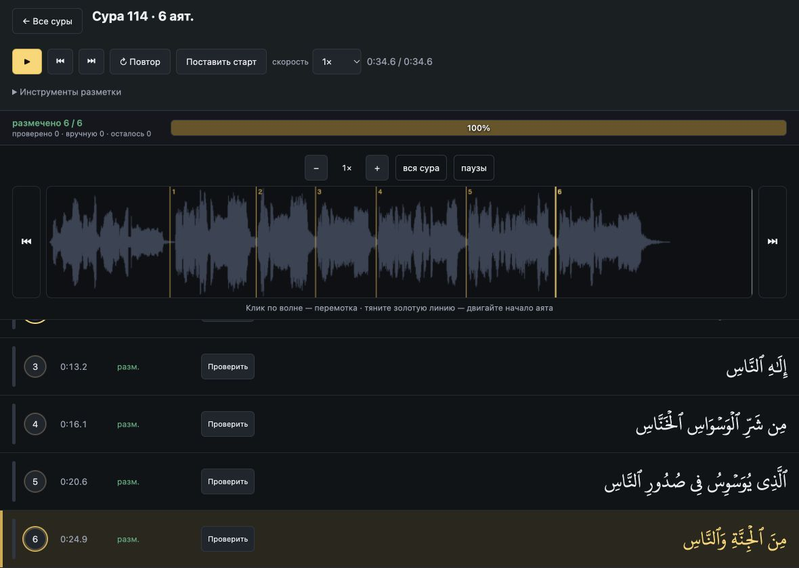
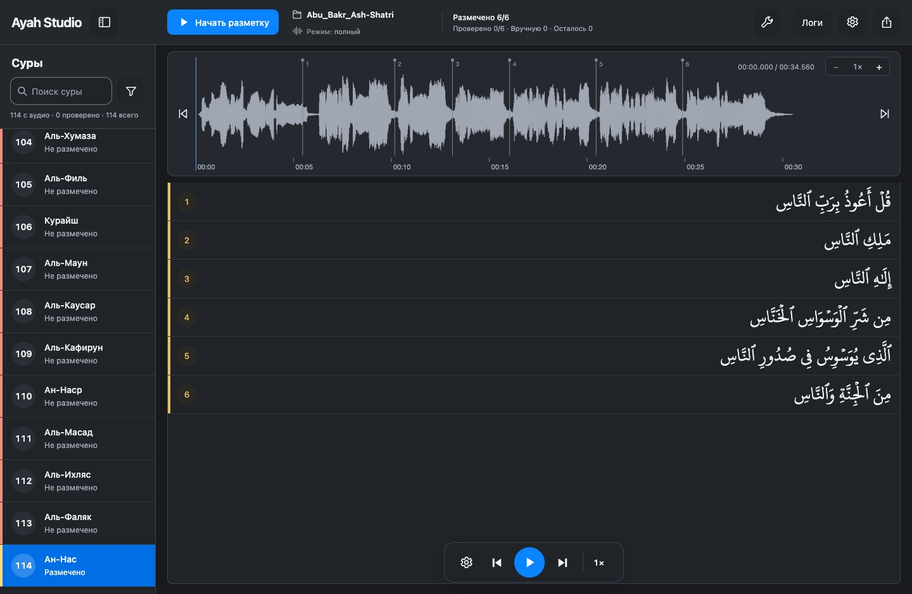
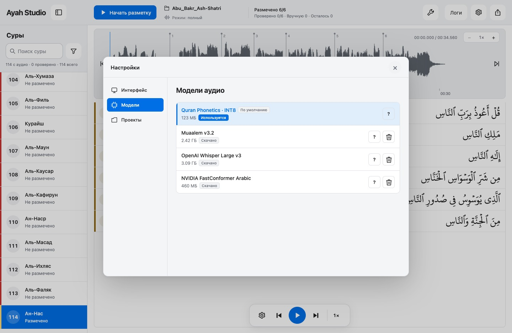

  
  <h1>Ayah Studio</h1>
  
От аудио Корана — к точной разметке аятов.

  
<a href="README.en.md">English</a> · <a href="https://github.com/Shishani58/Ayah-Studio/releases">Релизы</a> · <a href="LICENSE">MIT</a>

  

Приложение для macOS и Windows: расставляйте тайм-коды аятов, проверяйте их на слух
и сохраняйте готовую разметку. Всё работает локально, без загрузки аудио в облако.

## Установка

| Платформа | Скачать 0.2.0 |
| --- | --- |
| macOS · Apple Silicon | [DMG](https://github.com/Shishani58/Ayah-Studio/releases/download/v0.2.0/Ayah-Studio-0.2.0-macOS-arm64.dmg) |
| Windows · x64 | [ZIP с готовым EXE](https://github.com/Shishani58/Ayah-Studio/releases/download/v0.2.0/Ayah-Studio-0.2.0-Windows-x64.zip) |

Для **Mac с Apple Silicon** (M1 и новее). Откройте DMG, перетащите
**Ayah Studio** в **Applications / Программы** и запустите приложение.
**Windows:** распакуйте ZIP целиком и запустите **Ayah Studio.exe**.
Папку `_internal` оставьте рядом с EXE. Для окна приложения нужен
[Microsoft WebView2 Runtime](https://developer.microsoft.com/en-us/microsoft-edge/webview2/).

Python и исходники не нужны. Базовая модель включена в приложение;
дополнительные модели скачиваются по выбору в настройках.
Интерфейс доступен на русском и английском: язык системы выбирается при первом
запуске, затем его можно изменить в «Настройки → Интерфейс → Язык».

Сборка не нотарифицирована Apple. Если macOS блокирует первый запуск,
см. [инструкцию Apple](https://support.apple.com/ru-ru/102445).
Windows EXE пока без цифровой подписи. Mac Intel не проверялся.

## Главное

- **Три режима:** быстрый по паузам с локальной проверкой, полный и по словам.
- **Модели:** встроенная Quran Phonetics и загрузка Muaalem, FastConformer Arabic, Whisper Large-v3.
- **Проверка на слух:** волна, арабский текст, повтор аята и скорость воспроизведения.
- **Правка границ** мышью; ручные правки сохраняются при повторной генерации.
- **Проекты и оформление:** переключение проектов, светлая и тёмная темы.
- **Поиск и фильтры** по 114 сурам, продолжение незавершённой разметки.
- **Экспорт SQLite** для использования в приложениях Корана.

Каталог моделей

## Быстрый старт

1. Выберите папку с аудио: один файл на суру, имена `001.mp3` … `114.mp3`.
2. Добавьте проект в настройках «Проекты» и выберите режим разметки.
3. Откройте суру, прослушайте результат и отметьте проверенные аяты.
4. Когда все 114 сур готовы, экспортируйте базу.

Автоматическая разметка — черновик. Перед публикацией проверяйте границы на слух.

## Для разработчиков

[Сборка приложения и DMG](docs/development/packaging.md) ·
[Архитектура](docs/project.md) · [Статус проекта](docs/STATUS.md)

Код — MIT. Текст Корана, шрифт и модели сохраняют лицензии источников:
[благодарности и атрибуция](docs/attributions.md).
